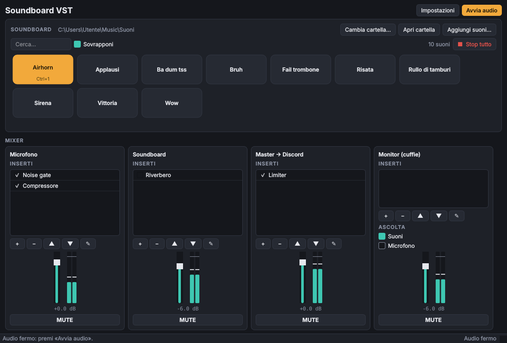

# Soundboard VST

Soundboard in stile Discord scritta in Python, con mixer, host per plugin VST3 e uscita verso un
microfono virtuale: Discord (o OBS, Teams, Zoom, qualsiasi programma con un ingresso audio) riceve
la tua voce **più** i suoni, già mixati ed elaborati.



## Funzionalità

- **Soundboard**: un pulsante per ogni file audio della cartella (`wav`, `mp3`, `ogg`, `flac`, `aif/aiff`).
  - Cartella predefinita `Musica\Suoni`, oppure una a scelta («Cambia cartella…»).
  - Aggiungi suoni dal pulsante o trascinandoli nella finestra; la cartella viene osservata e la griglia si aggiorna da sola.
  - Tasto destro su un suono: volume (0–200%), scorciatoia da tastiera, rinomina, sposta nel cestino.
  - «Sovrapponi» per far suonare lo stesso suono più volte insieme, «Stop tutto» per zittire tutto.
- **Ingresso**: scegli microfono o scheda audio.
- **Uscita verso Discord**: il mix va su un cavo audio virtuale, che gli altri programmi vedono come microfono.
- **Monitor**: uscita separata per le cuffie, per sentire i suoni (e, se vuoi, te stesso).
- **Mixer** con quattro canali — Microfono, Soundboard, Master → Discord, Monitor — ognuno con fader in dB, mute, meter stereo e catena di inserti.
- **Host VST3**: inserisci plugin VST3 in qualsiasi canale, riordinali, mettili in bypass, apri la loro interfaccia grafica o un editor parametri generico. Lo stato dei plugin viene salvato e ripristinato.
- **Effetti integrati** (non serve installare nulla): noise gate, compressore, limiter, filtri, EQ, riverbero, delay, chorus, distorsione, guadagno.

## Flusso del segnale

```
Microfono ──► [Microfono: inserti → fader] ──┐
                                             ├──► [Master → Discord: inserti → fader] ──► CABLE Input ──► Discord
Suoni ──────► [Soundboard: inserti → fader] ─┘
                     │                │
                     └── Suoni / Microfono (selezionabili) ──► [Monitor: inserti → fader] ──► cuffie
```

## Installazione (Windows)

1. Installa **Python 3.10 o superiore** da [python.org](https://www.python.org/downloads/) (spunta «Add Python to PATH»).
2. Installa un cavo audio virtuale, ad esempio **[VB-Audio Virtual Cable](https://vb-audio.com/Cable/)** (gratuito), e riavvia il PC.
3. Scarica questo repository ed esegui `run_windows.bat`: la prima volta crea un ambiente virtuale e installa le dipendenze.

In alternativa, a mano:

```bat
python -m venv .venv
.venv\Scripts\activate
pip install -r requirements.txt
python -m soundboard_vst
```

Funziona anche su Linux e macOS (su Linux serve `libportaudio2`; come cavo virtuale si può usare un sink PipeWire/PulseAudio, su macOS BlackHole).

## Collegarla a Discord

1. Apri **Impostazioni** nella soundboard:
   - *Driver*: **Windows WASAPI** (consigliato: nomi completi e latenza più bassa).
   - *Ingresso*: il tuo microfono.
   - *Uscita verso Discord*: **CABLE Input (VB-Audio Virtual Cable)** — viene rilevato e segnalato con ★.
   - *Monitor*: le tue cuffie.
2. In Discord: *Impostazioni utente → Voce e video → Dispositivo di input* = **CABLE Output (VB-Audio Virtual Cable)**.
3. Consigliato in Discord: disattiva la **soppressione del rumore** (Krisp) e il **controllo automatico del guadagno**, che tendono a tagliare musica ed effetti. Il noise gate e il compressore puoi metterli tu sul canale Microfono.

Lo stesso vale per qualsiasi altro programma: basta scegliere «CABLE Output» come microfono.

## Plugin VST3

- Le cartelle analizzate di default sono `C:\Program Files\Common Files\VST3` e quella `(x86)`; puoi aggiungerne altre in Impostazioni.
- Nel mixer, **+** → *Plugin VST3* elenca i plugin trovati; *Sfoglia file VST3…* ne carica uno da qualsiasi posizione.
- **Doppio clic** su un inserto apre la sua interfaccia grafica. Per un limite della libreria `pedalboard`, mentre l'interfaccia del plugin è aperta la finestra della soundboard resta in attesa (l'audio continua): chiudila per tornare ai pulsanti. Se vuoi regolare un plugin senza bloccare nulla, usa tasto destro → **Parametri…**.
- Spunta = inserto attivo, senza spunta = bypass. Se un plugin va in errore viene messo in bypass automaticamente per non interrompere l'audio.
- Sono supportati VST3 (e Audio Unit su macOS). I vecchi VST2 (`.dll`) non sono supportati da `pedalboard`; i plugin a 32 bit non si caricano in un Python a 64 bit.

## Impostazioni e latenza

Le impostazioni (dispositivi, cartella, volumi, mixer e stato dei plugin) sono salvate in
`%APPDATA%\SoundboardVST\config.json`.

Se senti crepitii o la barra di stato mostra molti *dropout*, aumenta il **Buffer** (1024 campioni);
se vuoi meno latenza prova 256. 48000 Hz è la frequenza usata da Discord.

## Struttura del progetto

```
src/soundboard_vst/
  app.py                 finestra principale
  config.py              impostazioni persistenti
  audio/engine.py        motore audio: stream, mix, routing
  audio/mixer.py         canale del mixer (inserti, fader, mute, meter)
  audio/plugins.py       inserti: effetti integrati e VST3
  audio/library.py       elenco e decodifica dei suoni
  audio/devices.py       dispositivi audio (sounddevice / PortAudio)
  audio/ringbuffer.py    buffer tra schede audio con clock diversi
  ui/                    soundboard, mixer, meter, finestre di dialogo
tests/                   test del motore e della libreria
```

Test: `pip install pytest` e poi `pytest`.

## Dipendenze

[PySide6](https://doc.qt.io/qtforpython-6/) (interfaccia), [sounddevice](https://python-sounddevice.readthedocs.io/) (audio),
[pedalboard](https://github.com/spotify/pedalboard) (VST3, effetti, decodifica audio), [NumPy](https://numpy.org/).
