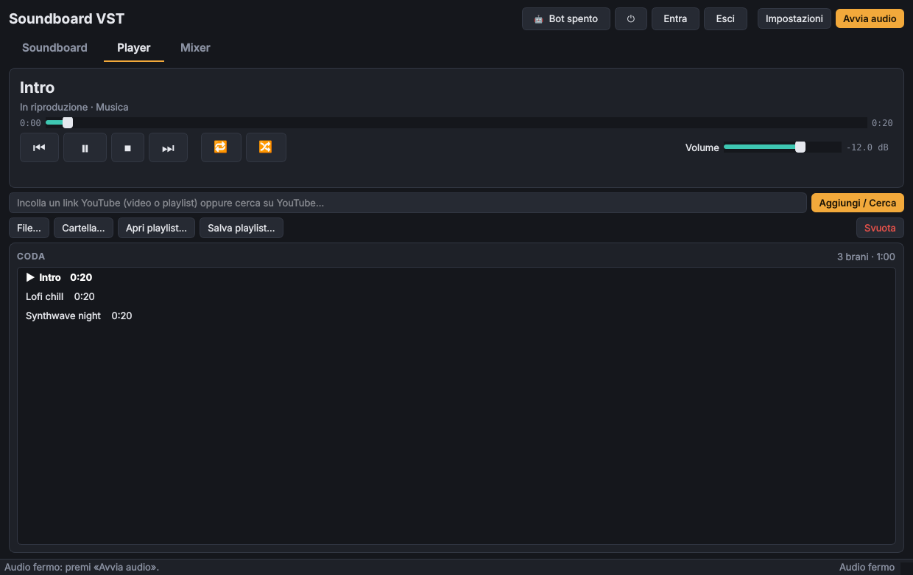
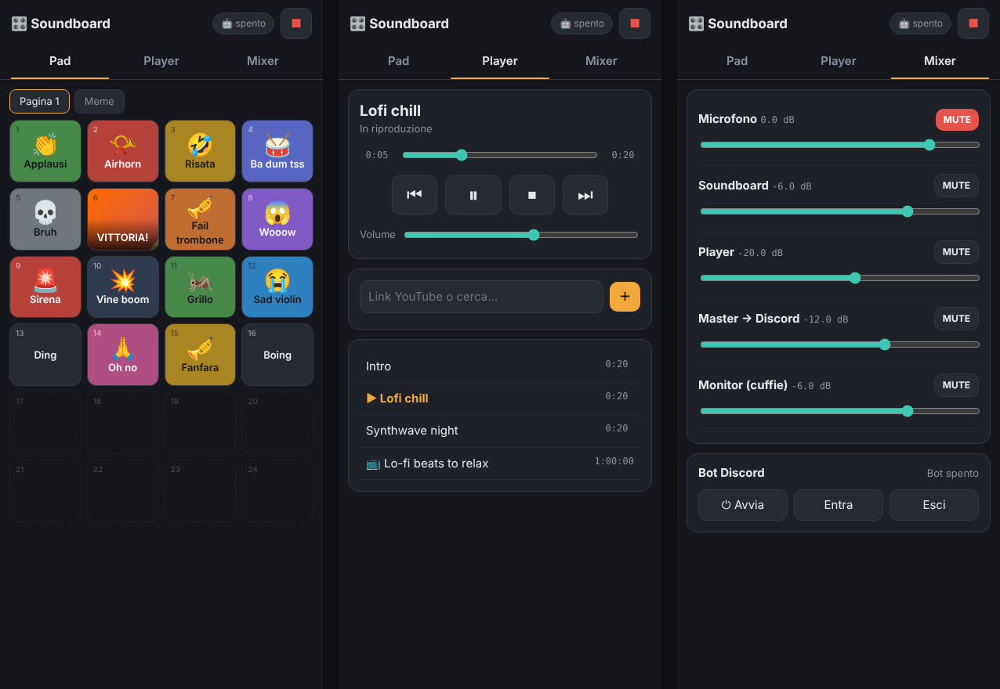

# Soundboard VST

Soundboard in stile Discord scritta in Python, con mixer, host per plugin VST3 e uscita verso un
microfono virtuale: Discord (o OBS, Teams, Zoom, qualsiasi programma con un ingresso audio) riceve
la tua voce **più** i suoni, già mixati ed elaborati.


## Funzionalità

- **Soundboard a pad** (tab *Soundboard*):
  - Griglia di pad regolabile fino a 12 × 12 (predefinita 6 × 8 = 48 slot) e **pagine** illimitate, rinominabili e riordinabili.
  - **Libreria** a sinistra con tutti i file della cartella (`wav`, `mp3`, `ogg`, `flac`, `aif/aiff`): trascina un suono su un pad per assegnarlo; i file che non sono su nessun pad appaiono in grigio.
  - Trascina un pad su un altro per spostarli o scambiarli; clic su uno slot vuoto per assegnargli un suono.
  - Cartella predefinita `Musica\Suoni`, oppure una a scelta. I file nuovi (aggiunti, trascinati dall'esplora risorse o scaricati) finiscono nel primo pad libero.
  - Tasto destro su un pad → *Personalizza…*: **nome sul pad**, **immagine**, volume (0–200%), **colore** (12 colori o uno a scelta), **icona emoji**, scorciatoia da tastiera e **nota MIDI**. Dallo stesso menu: togli dal pad, rinomina il file, sposta nel cestino.
- **Controller MIDI**: scegli il controller in Impostazioni → MIDI, poi su un suono premi **Impara** e suona una nota o un pad (note e controlli CC, con il canale). Opzionalmente la forza con cui premi (velocity) regola il volume.
  - «Sovrapponi» per far suonare lo stesso suono più volte insieme, «Stop tutto» per zittire tutto.
- **Ricerca su [MyInstants](https://www.myinstants.com)** direttamente dall'app: cerca o sfoglia le tendenze, ascolta l'anteprima solo in cuffia (non arriva a Discord), e aggiungi il suono con un clic: viene scaricato nella cartella e messo su un pad.
- **Player** (tab *Player*): coda di brani da file, cartelle, playlist `.m3u`, **video e playlist di YouTube** e ricerca su YouTube, con un suo canale nel mixer. La musica arriva a Discord (tramite bot o cavo virtuale) e in cuffia.
- **Controllo remoto da browser**: una pagina per telefono o tablet con pad, player (anche link YouTube), mixer e
  comandi del bot, protetta da una chiave; si apre inquadrando un QR code. Dall'esterno funziona con Tailscale.
- **Bot Discord integrato**: il bot entra nel canale vocale in cui ti trovi (e ti segue se cambi canale) e riproduce i suoni che premi, con gli effetti e il fader del canale Soundboard. Per i suoni non serve VB-Cable.
- **Comandi e pulsantiera su Discord**: `/suona`, `/pulsantiera` (i pad come pulsanti in un messaggio), un **canale dedicato** con tutti i pad sempre aggiornati, e comandi per player, volume ed entrata/uscita del bot, con permessi per ruolo.
- **Sintesi vocale**: scrivi una frase e la soundboard la dice (anche su Discord), con voci neurali Microsoft o voci del sistema offline; e **frasi sui pad**, che funzionano come gli altri suoni.
- **Ingresso**: scegli microfono o scheda audio.
- **Uscita verso Discord**: il mix va su un cavo audio virtuale, che gli altri programmi vedono come microfono.
- **Monitor**: uscita separata per le cuffie, per sentire i suoni (e, se vuoi, te stesso).
- **Mixer** (tab *Mixer*) con cinque canali — Microfono, Soundboard, Player, Master → Discord, Monitor — ognuno con fader in dB, mute, meter stereo e catena di inserti.
- **Host VST3**: inserisci plugin VST3 in qualsiasi canale, riordinali, mettili in bypass, apri la loro interfaccia grafica o un editor parametri generico. Lo stato dei plugin viene salvato e ripristinato.
- **Effetti integrati** (non serve installare nulla): noise gate, compressore, limiter, filtri, EQ, riverbero, delay, chorus, distorsione, guadagno e **pitch shifter** a bassa latenza (±12 semitoni, ~20 ms).
- **Mappa MIDI**: volumi e mute di ogni canale, controlli del player, pad della pagina corrente, cambio pagina e bot assegnabili a potenziometri, fader e tasti del controller, con preset per **Nektar Impact LX25+**.


## Flusso del segnale

```
Microfono ──► [Microfono: inserti → fader] ──┐
                                             ├──► [Master → Discord: inserti → fader] ──► CABLE Input ──► Discord
Suoni ──────► [Soundboard: inserti → fader] ─┤
Player ─────► [Player: inserti → fader] ─────┘
                     │                │
                     └── Suoni / Player / Microfono (selezionabili) ──► [Monitor: inserti → fader] ──► cuffie

Con il bot in canale, Soundboard e Player vanno al bot invece che al cavo virtuale.
```

## Installazione (Windows)

### Versione pronta

Scarica `SoundboardVST-…-windows-x64.zip` dall'ultima [release](https://github.com/ZioLadro/soundboard-vst/releases),
estrailo e avvia `SoundboardVST.exe`: non serve installare Python. Windows SmartScreen potrebbe
avvisare perché l'eseguibile non è firmato: «Ulteriori informazioni» → «Esegui comunque».

### Da sorgente

1. Installa **Python 3.10 o superiore** da [python.org](https://www.python.org/downloads/) (spunta «Add Python to PATH»).
2. Installa un cavo audio virtuale, ad esempio **[VB-Audio Virtual Cable](https://vb-audio.com/Cable/)** (gratuito), e riavvia il PC.
3. Scarica questo repository ed esegui `run_windows.bat`: la prima volta crea un ambiente virtuale e installa le dipendenze.

In alternativa, a mano:

```bat
python -m venv .venv
.venv\Scripts\activate
pip install -r requirements.txt
python -m soundboard_vst
```

Funziona anche su Linux e macOS (su Linux serve `libportaudio2`; come cavo virtuale si può usare un sink PipeWire/PulseAudio, su macOS BlackHole).

## Perché serve VB-Cable

Windows non permette a un programma di creare da solo un nuovo microfono: per farlo serve un driver
audio, ed è proprio quello che installa VB-Audio Virtual Cable (gratuito, una volta sola). Senza un
cavo virtuale la soundboard funziona lo stesso, ma i suoni li senti solo tu in cuffia.
In Impostazioni c'è un pulsante che apre la pagina di download ufficiale.

## Collegarla a Discord

1. Apri **Impostazioni** nella soundboard:
   - *Driver*: **Windows WASAPI** (consigliato: nomi completi e latenza più bassa).
   - *Ingresso*: il tuo microfono.
   - *Uscita verso Discord*: **CABLE Input (VB-Audio Virtual Cable)** — viene rilevato e segnalato con ★.
   - *Monitor*: le tue cuffie.
2. In Discord: *Impostazioni utente → Voce e video → Dispositivo di input* = **CABLE Output (VB-Audio Virtual Cable)**.
3. Consigliato in Discord: disattiva la **soppressione del rumore** (Krisp) e il **controllo automatico del guadagno**, che tendono a tagliare musica ed effetti. Il noise gate e il compressore puoi metterli tu sul canale Microfono.

Lo stesso vale per qualsiasi altro programma: basta scegliere «CABLE Output» come microfono.

## Gli altri sentono la propria voce (eco)

Succede quando l'audio di Discord rientra nel cavo virtuale e torna nel microfono. Controlla:

1. **Discord → Voce e video → Dispositivo di output**: devono essere le tue cuffie, **non** «CABLE Input» né «Predefinito» se il predefinito è il cavo.
2. **Windows → Impostazioni → Sistema → Audio → Output**: il dispositivo predefinito devono essere le cuffie, non «CABLE Input» (l'installazione di VB-Cable a volte lo imposta da sola).
3. **Ingresso della soundboard**: deve essere il microfono, non «CABLE Output» o «Missaggio stereo», che registrano l'audio del PC.
4. **Monitor della soundboard**: le cuffie, non il cavo.
5. Se usi le **casse** invece delle cuffie, il microfono riprende le voci degli altri: usa le cuffie, oppure lascia attiva la **cancellazione dell'eco** di Discord.

La soundboard riconosce i casi 2, 3 e 4 e mostra un avviso quando avvii l'audio.

## Bot Discord

Il bot fa sentire i suoni nel canale vocale come un utente a parte: tu continui a parlare dal tuo
Discord normale, e per i suoni non serve il cavo virtuale.

1. **Crea il bot**: apri il [portale sviluppatori](https://discord.com/developers/applications) →
   *New Application* → sezione **Bot** → **Reset Token** e copia il token (non serve attivare nessun intent privilegiato).
2. **Impostazioni → Bot Discord**: incolla il token e premi **Invita il bot nel server…**, scegli il server e conferma
   (il bot chiede i permessi *Connetti* e *Parla*, *Visualizza canale* e *Invia messaggi* per la pulsantiera,
   e l'uso dei comandi slash).
3. **Il tuo ID utente**: in Discord attiva *Impostazioni → Avanzate → Modalità sviluppatore*, poi tasto destro sul tuo
   nome → **Copia ID utente** e incollalo nelle impostazioni.
4. Dal pulsante ⏻ in alto (o dal menu 🤖) avvia il bot. Con «Segui me» attivo entra nel tuo canale, ti segue quando cambi
   canale ed esce quando esci; altrimenti usa **Entra nel mio canale**.

**Più persone con la soundboard**: ognuno deve creare il **proprio bot** con il proprio token (passi 1–3).
Un bot è un solo account Discord: può stare in un solo canale vocale per server e trasmettere un solo
flusso audio, quindi due soundboard con lo stesso token se lo contenderebbero. Con un bot a testa,
entrambi i bot entrano nello stesso canale e ognuno riproduce i suoni del proprio utente. Se la
soundboard trova il bot già occupato da un'altra soundboard, non lo «ruba» e mostra un avviso.

**Tasti rapidi del bot**: accanto al pulsante 🤖 ci sono ⏻ (avvia/ferma), **Entra** ed **Esci**. Da tastiera, di
default: `Ctrl+Alt+B` avvia/ferma, `Ctrl+Alt+J` entra nel tuo canale, `Ctrl+Alt+L` esce, `Ctrl+Alt+F` attiva o
disattiva «Segui me» (si cambiano in Impostazioni → Bot Discord). Si possono assegnare anche a tasti MIDI dalla mappa.

Note:
- Il bot trasmette i canali **Soundboard** e **Player** del mixer (inserti e fader compresi), non il microfono; l'anteprima di MyInstants resta solo in cuffia.
- Con «Con il bot in canale, i suoni non passano dal microfono virtuale» (attivo di default) il canale non sente i suoni due volte.
- **Latenza**: con «Bassa latenza: trasmissione continua» (attiva di default) il bot resta sempre in trasmissione e
  manda silenzio quando non suona niente, così i suoni partono subito (circa 20 ms di ritardo interno; il resto dipende
  dalla rete e da Discord). Su Discord il bot può però risultare sempre «attivo». Disattivandola, il bot va in pausa
  dopo mezzo secondo di silenzio e riparte alla pressione successiva (circa 40 ms interni, più l'avvio lato Discord).
  Il menu 🤖 mostra l'ultima latenza interna misurata.
- Usa discord.py 2.7 con il supporto alla crittografia end-to-end della voce (DAVE), obbligatoria su Discord.
- Il token è salvato in chiaro in `%APPDATA%\SoundboardVST\config.json`: chi lo ha può controllare il bot, quindi non condividere quel file. Se il token esce per sbaglio, rigeneralo dal portale.

## Comandi e pulsantiera su Discord

Con il bot online, in qualsiasi canale di testo del server:

| Comando | Cosa fa |
|---------|---------|
| `/suona suono:` | Riproduce un suono; mentre scrivi suggerisce i nomi (anche i suoni non sui pad) |
| `/stop` | Ferma tutti i suoni |
| `/pulsantiera [pagina] [privata]` | Pubblica i pad come pulsanti, 20 alla volta, con ◀ ▶ per scorrere pagine, ■ stop e ↻ aggiorna. Con `privata` la vedi solo tu |
| `/canale-pulsantiera` | **Usa questo canale**: il bot ci tiene tutti i pad (25 per messaggio) più stop e comandi del player, e li aggiorna da solo quando cambi i pad. **Rimuovi** cancella i messaggi |
| `/entra` · `/esci` | Il bot entra nel canale vocale di chi scrive il comando, o esce |
| `/player` · `/riproduci` | Play/pausa, stop, successivo, precedente · aggiunge un link o una ricerca di YouTube |
| `/volume canale: db:` | Volume di un canale del mixer, da −60 a +12 dB |
| `/parla testo:` | La sintesi vocale dice la frase (fino a 300 caratteri) |
| `/aiuto` | Elenco dei comandi |

I colori dei pulsanti seguono quelli dei pad (rosso, verde, blu o grigio: Discord ha solo questi quattro) e l'emoji compare nel testo. I pulsanti funzionano anche dopo aver riavviato la soundboard. Per il canale dedicato conviene un canale in cui solo il bot può scrivere.

**Permessi** (Impostazioni → Bot Discord):

- *Chi può suonare*: pad, `/suona`, `/stop`, `/pulsantiera`. Predefinito: **chiunque nel server**.
- *Chi può controllare*: `/entra`, `/esci`, player, `/riproduci`, `/volume`, `/canale-pulsantiera`. Predefinito: **solo io**.
- Per entrambi puoi scegliere «Solo io», «Io e chi ha il ruolo indicato» (nome o ID del ruolo) o «Chiunque nel server». Il proprietario (il tuo ID utente) può sempre usare tutto.
- Se disattivi «Comandi da Discord», il bot li toglie dai server.

**Bot invitato con una versione precedente**: invitalo di nuovo con «Invita il bot nel server…» (non serve toglierlo prima). Il nuovo link aggiunge i comandi e i permessi *Visualizza canale* e *Invia messaggi* per il canale dedicato. I comandi compaiono subito nei server in cui c'è il bot; se Discord non li mostra, riavvia il client Discord (Ctrl+R).

## Sintesi vocale e frasi sui pad

- **Al volo**: scrivi nella barra 💬 sotto i pad e premi **Invio** (o **Parla**). La frase passa dal canale *Soundboard* del mixer, quindi arriva a Discord (cavo virtuale o bot) e in cuffia come un suono. Invio di nuovo la ripete.
- **Sui pad**: tasto destro su un pad vuoto → **Nuova frase…**, oppure **Salva su un pad** dalla barra. Tasto destro sulla frase → *Modifica frase…* per cambiare testo o voce, *Personalizza…* per nome, colore, emoji, immagine, volume, scorciatoia e nota MIDI. Le frasi stanno anche nella libreria (💬) e si trascinano tra pad e pagine come i file.
- **Da Discord**: `/parla testo:`; le frasi sui pad compaiono nella pulsantiera e in `/suona`. **Dal telefono**: campo «Scrivi una frase da far dire…» nella scheda Pad.

**Impostazioni → Sintesi vocale**: motore, voce predefinita, velocità, tono e un campo di prova che senti solo in cuffia.

| Motore | Pro | Contro |
|--------|-----|--------|
| **Voci neurali Microsoft** (predefinito, voce Diego) | Molto naturali, decine di lingue e voci | Serve Internet; usa il servizio delle voci di Microsoft Edge tramite [edge-tts](https://github.com/rany2/edge-tts), non ufficiale: potrebbe cambiare |
| **Voci del sistema** | Offline, istantanee | Meno naturali; su Windows quelle installate (es. *Microsoft Elsa* per l'italiano), su Linux serve `espeak-ng` |

Ogni frase viene creata una volta sola e tenuta in una cache (`%APPDATA%\SoundboardVST\cache\tts`, massimo 200 MB): dalla seconda volta parte subito, e le frasi sui pad vengono preparate all'avvio. Cambiando voce, velocità o tono la frase viene ricreata.

## MIDI

1. Collega il controller e aprilo in **Impostazioni → MIDI → Controller**.
2. Tasto destro su un pad → **Personalizza…** → **Impara**, poi premi la nota o il pad sul controller.
3. Sul pad compare la nota assegnata (es. `C2 · ch 10`); una nota suona un solo suono, quindi assegnarla a un altro la toglie dal precedente.

**Mappa dei controlli** (Impostazioni → MIDI): ogni funzione ha il suo «Impara».
- Volumi dei 5 canali (potenziometri o fader, CC), mute dei canali, Play/Pausa, Stop, Successivo, Precedente,
  Stop tutti i suoni, pagina precedente/successiva, **Pad 1–16 della pagina corrente**, e il bot (avvia/ferma,
  entra, esci, segui me).
- Le assegnazioni della mappa hanno la precedenza sulle note dei singoli suoni.

**Preset Nektar Impact LX25+** (preset 1 «GM Instrument», quello di fabbrica; valori dal manuale):

| Controllo LX25+ | Messaggio | Funzione |
|---|---|---|
| Fader | CC 7 | Volume Master → Discord |
| Pot 1 | CC 74 | Volume Microfono |
| Pot 2 | CC 71 | Volume Soundboard |
| Pot 3 | CC 5 | Volume Player |
| Pot 4 | CC 84 | Volume Monitor |
| Pad 1–8 | note 36–43 | Pad 1–8 della pagina corrente |

I pot 5–8 (CC 78, 76, 77, 10) restano liberi per quello che vuoi. Il manuale non indica i messaggi dei tasti di
trasporto, quindi vanno assegnati con «Impara» (per esempio Play → Play/Pausa, Stop → Stop, ◀◀/▶▶ →
Precedente/Successivo). Se la tastiera è su un altro preset, usa «Impara» anche per il resto.

Le note seguono la convenzione con il Do centrale = C4 (nota 60); alcuni programmi la chiamano C3.
L'eseguibile della release include già il supporto MIDI. Da sorgente serve `python-rtmidi`, che su Windows ha
pacchetti pronti fino a Python 3.12: con versioni più recenti la soundboard funziona ma senza MIDI.

## Player



Nella tab **Player**:
- **File…**, **Cartella…** (anche sottocartelle) o trascina file e cartelle nella finestra. Legge mp3, flac, wav, ogg, opus, m4a, aac, wma e l'audio dei video (mp4, mkv, webm…).
- Nella barra in alto incolla un **link di YouTube** (video o playlist) e premi Invio; se scrivi altro, **cerca su YouTube** e mostra i risultati: doppio clic per riprodurre, oppure selezionali e aggiungili.
- **Apri/Salva playlist** in formato `.m3u` (anche con link di YouTube). La coda viene ricordata alla chiusura.
- Trascina i brani per riordinarli, `Canc` per toglierli; ripeti (no / coda / brano) e casuale.
- Il volume del Player è il canale *Player* del mixer, con i suoi inserti; nel monitor puoi scegliere se sentirlo.

Di YouTube si riproduce solo l'audio: prima di suonare, il brano viene scaricato da yt-dlp in una cache
(`%APPDATA%\SoundboardVST\cache\youtube`, massimo 1,5 GB, poi si cancellano i file usati meno di recente), così una
canzone già ascoltata riparte subito e il brano successivo della coda viene scaricato in anticipo. La lettura dei link usa [yt-dlp](https://github.com/yt-dlp/yt-dlp) con Deno e ffmpeg
inclusi nell'eseguibile. YouTube cambia spesso: se smette di funzionare, aggiorna alla release più recente (ogni build
prende l'ultima versione di yt-dlp). Scaricare o trasmettere contenuti di YouTube con strumenti esterni è contrario ai
suoi termini di servizio, e la musica è spesso protetta da diritti: usalo per uso personale e con cognizione.

## Controllo remoto (telefono, tablet, altro PC)



1. **Impostazioni → Controllo remoto** → spunta «Attiva il controllo da browser» (porta predefinita 8765) e salva.
   La prima volta Windows chiede il permesso di rete: consenti l'accesso sulle **reti private**.
2. Premi **📱** in alto: inquadra il **QR code** con il telefono (connesso alla stessa rete Wi-Fi) oppure copia il link.
3. Sulla pagina trovi tre schede: **Pad** (tutte le pagine, con colori, emoji e immagini), **Player** (in riproduzione,
   avanzamento, comandi, volume, coda; puoi incollare un link YouTube o scrivere una ricerca: viene aggiunto il primo
   risultato) e **Mixer** (volumi e mute dei canali, avvio/ingresso/uscita del bot). Il ■ in alto ferma tutti i suoni.
   Aggiungi la pagina alla schermata Home per usarla come un'app.

Il link contiene una **chiave di accesso**: chi ce l'ha può controllare la soundboard. Dopo la prima apertura la chiave
viene tolta dall'indirizzo e salvata in un cookie. Se la condividi per sbaglio, premi **Nuova chiave** nelle
impostazioni: i link vecchi smettono di funzionare.

**Dall'esterno di casa:**
- **Tailscale (consigliato)**: installa [Tailscale](https://tailscale.com) (gratuito) sul PC e sul telefono con lo
  stesso account. Nella finestra 📱 comparirà un link «Tailscale (da ovunque)» con un indirizzo `100.x.x.x`: funziona
  da qualunque rete, il traffico è cifrato e non serve aprire porte sul router.
- **Port forwarding**: inoltra la porta (8765) del router verso il PC e usa `http://<IP pubblico>:8765/?k=<chiave>`.
  Funziona, ma il collegamento **non è cifrato** e la pagina è esposta su Internet, protetta solo dalla chiave.

## Cercare suoni su MyInstants

Premi **Cerca su MyInstants** nella tab Soundboard, scrivi cosa cerchi e premi Invio (oppure
**Tendenze** per i più popolari in Italia). Doppio clic o **Ascolta in cuffia** per l'anteprima,
**Aggiungi ai pad** per scaricarlo. MyInstants non ha un'API ufficiale documentata: l'app legge la sua
pagina di ricerca, quindi se il sito cambia struttura la ricerca potrebbe smettere di funzionare fino
a un aggiornamento. Molti suoni sono estratti da film, serie e canzoni: usali per divertimento personale.


## Plugin VST3

- Le cartelle analizzate di default sono `C:\Program Files\Common Files\VST3` e quella `(x86)`; puoi aggiungerne altre in Impostazioni.
- Nel mixer, **+** → *Plugin VST3* elenca i plugin trovati; *Sfoglia file VST3…* ne carica uno da qualsiasi posizione.
- **Doppio clic** su un inserto apre la sua interfaccia grafica. Per un limite della libreria `pedalboard`, mentre l'interfaccia del plugin è aperta la finestra della soundboard resta in attesa (l'audio continua): chiudila per tornare ai pulsanti. Se vuoi regolare un plugin senza bloccare nulla, usa tasto destro → **Parametri…**.
- Spunta = inserto attivo, senza spunta = bypass. Se un plugin va in errore viene messo in bypass automaticamente per non interrompere l'audio.
- Sono supportati VST3 (e Audio Unit su macOS). I vecchi VST2 (`.dll`) non sono supportati da `pedalboard`; i plugin a 32 bit non si caricano in un Python a 64 bit.

## Impostazioni e latenza

Le impostazioni (dispositivi, cartella, pad e pagine, volumi, mixer e stato dei plugin) sono salvate in
`%APPDATA%\SoundboardVST\config.json`.

Se senti crepitii o la barra di stato mostra molti *dropout*, aumenta il **Buffer** (1024 campioni);
se vuoi meno latenza prova 256. 48000 Hz è la frequenza usata da Discord.

## Struttura del progetto

```
src/soundboard_vst/
  app.py                 finestra principale (tab Soundboard e Mixer)
  config.py              impostazioni persistenti
  pads.py                pagine e slot dei pad
  myinstants.py          ricerca e download da myinstants.com
  midi.py                ingresso MIDI (python-rtmidi)
  midi_map.py            mappa MIDI dei controlli e preset dei controller
  youtube.py             link, playlist e ricerca di YouTube (yt-dlp)
  binaries.py            ffmpeg e Deno inclusi
  remote/server.py       server web del controllo remoto (aiohttp)
  remote/page.py         pagina web per telefono
  audio/player.py        lettore (coda, decodifica con ffmpeg)
  audio/pitch.py         pitch shifter a bassa latenza
  discord_bot.py         bot Discord (discord.py) che trasmette il canale Soundboard
  discord_commands.py    comandi slash, pulsantiera e canale dedicato del bot
  tts.py                 sintesi vocale (voci neurali e di sistema), cache delle frasi
  audio/engine.py        motore audio: stream, mix, routing
  audio/mixer.py         canale del mixer (inserti, fader, mute, meter)
  audio/plugins.py       inserti: effetti integrati e VST3
  audio/library.py       elenco e decodifica dei suoni
  audio/devices.py       dispositivi audio (sounddevice / PortAudio)
  audio/ringbuffer.py    buffer tra schede audio con clock diversi
  ui/                    soundboard, mixer, meter, finestre di dialogo
tests/                   test del motore e della libreria
```

Test: `pip install pytest` e poi `pytest`.

## Release

A ogni push su `main` la stessa Action compila e verifica l'eseguibile e lo salva come artefatto
(scaricabile dalla pagina del run per 14 giorni). Pubblicando una release su GitHub (tag `vX.Y.Z`) la GitHub Action `Build release` compila
l'eseguibile Windows con PyInstaller, lo verifica e allega lo zip alla release. Per una release già
esistente: *Actions → Build release → Run workflow* e indica il tag.

## Dipendenze

[PySide6](https://doc.qt.io/qtforpython-6/) (interfaccia), [sounddevice](https://python-sounddevice.readthedocs.io/) (audio),
[pedalboard](https://github.com/spotify/pedalboard) (VST3, effetti, decodifica audio), [NumPy](https://numpy.org/),
[python-rtmidi](https://github.com/SpotlightKid/python-rtmidi) (MIDI), [discord.py](https://github.com/Rapptz/discord.py) (bot Discord),
[yt-dlp](https://github.com/yt-dlp/yt-dlp) con [Deno](https://deno.com) (YouTube), [aiohttp](https://docs.aiohttp.org) e
[segno](https://github.com/heuer/segno) (controllo remoto e QR code), [edge-tts](https://github.com/rany2/edge-tts) (voci neurali), [imageio-ffmpeg](https://github.com/imageio/imageio-ffmpeg) (ffmpeg per la decodifica).
