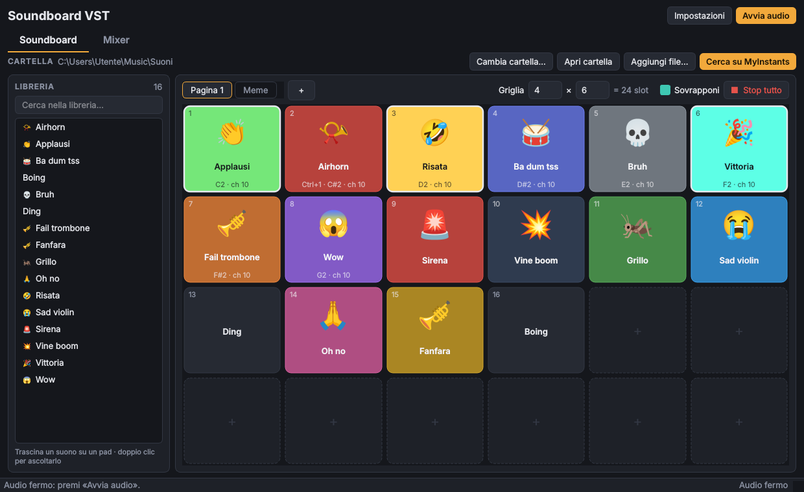
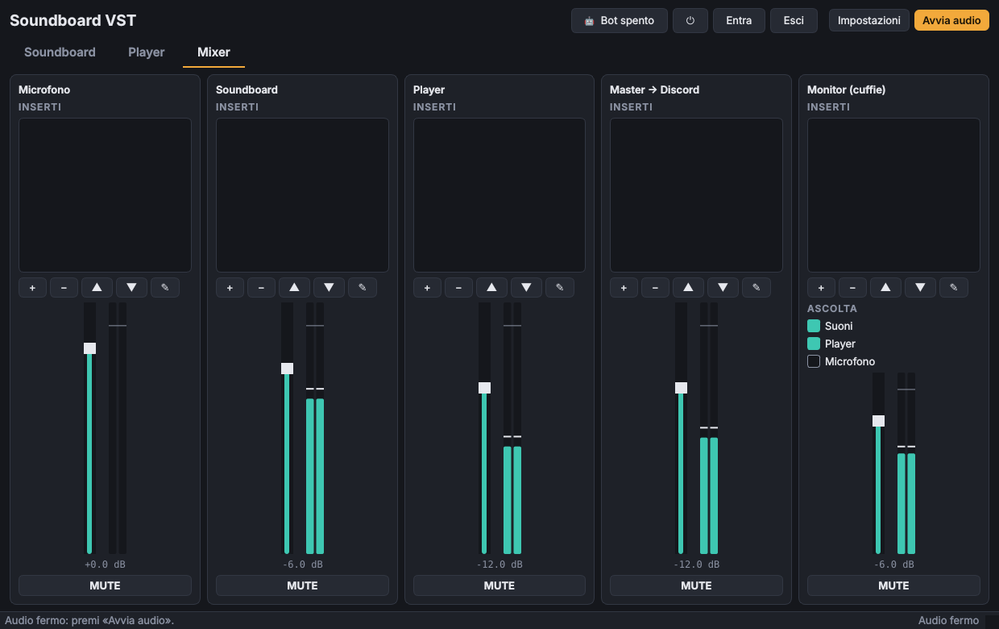
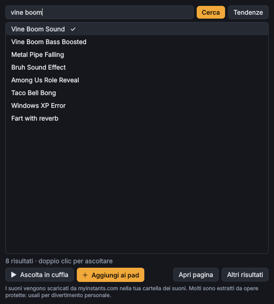

# Soundboard VST

Soundboard in stile Discord scritta in Python, con mixer, host per plugin VST3 e uscita verso un
microfono virtuale: Discord (o OBS, Teams, Zoom, qualsiasi programma con un ingresso audio) riceve
la tua voce **più** i suoni, già mixati ed elaborati.



## Funzionalità

- **Soundboard a pad** (tab *Soundboard*):
  - Griglia di pad regolabile fino a 12 × 12 (predefinita 6 × 8 = 48 slot) e **pagine** illimitate, rinominabili e riordinabili.
  - **Libreria** a sinistra con tutti i file della cartella (`wav`, `mp3`, `ogg`, `flac`, `aif/aiff`): trascina un suono su un pad per assegnarlo; i file che non sono su nessun pad appaiono in grigio.
  - Trascina un pad su un altro per spostarli o scambiarli; clic su uno slot vuoto per assegnargli un suono.
  - Cartella predefinita `Musica\Suoni`, oppure una a scelta. I file nuovi (aggiunti, trascinati dall'esplora risorse o scaricati) finiscono nel primo pad libero.
  - Tasto destro su un pad → *Volume, colore e MIDI…*: volume (0–200%), **colore** del pad (12 colori o uno a scelta), **icona emoji**, scorciatoia da tastiera e **nota MIDI**. Dallo stesso menu: togli dal pad, rinomina, sposta nel cestino.
- **Controller MIDI**: scegli il controller in Impostazioni → MIDI, poi su un suono premi **Impara** e suona una nota o un pad (note e controlli CC, con il canale). Opzionalmente la forza con cui premi (velocity) regola il volume.
  - «Sovrapponi» per far suonare lo stesso suono più volte insieme, «Stop tutto» per zittire tutto.
- **Ricerca su [MyInstants](https://www.myinstants.com)** direttamente dall'app: cerca o sfoglia le tendenze, ascolta l'anteprima solo in cuffia (non arriva a Discord), e aggiungi il suono con un clic: viene scaricato nella cartella e messo su un pad.
- **Bot Discord integrato**: il bot entra nel canale vocale in cui ti trovi (e ti segue se cambi canale) e riproduce i suoni che premi, con gli effetti e il fader del canale Soundboard. Per i suoni non serve VB-Cable.
- **Ingresso**: scegli microfono o scheda audio.
- **Uscita verso Discord**: il mix va su un cavo audio virtuale, che gli altri programmi vedono come microfono.
- **Monitor**: uscita separata per le cuffie, per sentire i suoni (e, se vuoi, te stesso).
- **Mixer** (tab *Mixer*) con quattro canali — Microfono, Soundboard, Master → Discord, Monitor — ognuno con fader in dB, mute, meter stereo e catena di inserti.
- **Host VST3**: inserisci plugin VST3 in qualsiasi canale, riordinali, mettili in bypass, apri la loro interfaccia grafica o un editor parametri generico. Lo stato dei plugin viene salvato e ripristinato.
- **Effetti integrati** (non serve installare nulla): noise gate, compressore, limiter, filtri, EQ, riverbero, delay, chorus, distorsione, guadagno.



## Flusso del segnale

```
Microfono ──► [Microfono: inserti → fader] ──┐
                                             ├──► [Master → Discord: inserti → fader] ──► CABLE Input ──► Discord
Suoni ──────► [Soundboard: inserti → fader] ─┘
                     │                │
                     └── Suoni / Microfono (selezionabili) ──► [Monitor: inserti → fader] ──► cuffie
```

## Installazione (Windows)

### Versione pronta

Scarica `SoundboardVST-…-windows-x64.zip` dall'ultima [release](https://github.com/ZioLadro/soundboard-vst/releases),
estrailo e avvia `SoundboardVST.exe`: non serve installare Python. Windows SmartScreen potrebbe
avvisare perché l'eseguibile non è firmato: «Ulteriori informazioni» → «Esegui comunque».

### Da sorgente

1. Installa **Python 3.10 o superiore** da [python.org](https://www.python.org/downloads/) (spunta «Add Python to PATH»).
2. Installa un cavo audio virtuale, ad esempio **[VB-Audio Virtual Cable](https://vb-audio.com/Cable/)** (gratuito), e riavvia il PC.
3. Scarica questo repository ed esegui `run_windows.bat`: la prima volta crea un ambiente virtuale e installa le dipendenze.

In alternativa, a mano:

```bat
python -m venv .venv
.venv\Scripts\activate
pip install -r requirements.txt
python -m soundboard_vst
```

Funziona anche su Linux e macOS (su Linux serve `libportaudio2`; come cavo virtuale si può usare un sink PipeWire/PulseAudio, su macOS BlackHole).

## Perché serve VB-Cable

Windows non permette a un programma di creare da solo un nuovo microfono: per farlo serve un driver
audio, ed è proprio quello che installa VB-Audio Virtual Cable (gratuito, una volta sola). Senza un
cavo virtuale la soundboard funziona lo stesso, ma i suoni li senti solo tu in cuffia.
In Impostazioni c'è un pulsante che apre la pagina di download ufficiale.

## Collegarla a Discord

1. Apri **Impostazioni** nella soundboard:
   - *Driver*: **Windows WASAPI** (consigliato: nomi completi e latenza più bassa).
   - *Ingresso*: il tuo microfono.
   - *Uscita verso Discord*: **CABLE Input (VB-Audio Virtual Cable)** — viene rilevato e segnalato con ★.
   - *Monitor*: le tue cuffie.
2. In Discord: *Impostazioni utente → Voce e video → Dispositivo di input* = **CABLE Output (VB-Audio Virtual Cable)**.
3. Consigliato in Discord: disattiva la **soppressione del rumore** (Krisp) e il **controllo automatico del guadagno**, che tendono a tagliare musica ed effetti. Il noise gate e il compressore puoi metterli tu sul canale Microfono.

Lo stesso vale per qualsiasi altro programma: basta scegliere «CABLE Output» come microfono.

## Gli altri sentono la propria voce (eco)

Succede quando l'audio di Discord rientra nel cavo virtuale e torna nel microfono. Controlla:

1. **Discord → Voce e video → Dispositivo di output**: devono essere le tue cuffie, **non** «CABLE Input» né «Predefinito» se il predefinito è il cavo.
2. **Windows → Impostazioni → Sistema → Audio → Output**: il dispositivo predefinito devono essere le cuffie, non «CABLE Input» (l'installazione di VB-Cable a volte lo imposta da sola).
3. **Ingresso della soundboard**: deve essere il microfono, non «CABLE Output» o «Missaggio stereo», che registrano l'audio del PC.
4. **Monitor della soundboard**: le cuffie, non il cavo.
5. Se usi le **casse** invece delle cuffie, il microfono riprende le voci degli altri: usa le cuffie, oppure lascia attiva la **cancellazione dell'eco** di Discord.

La soundboard riconosce i casi 2, 3 e 4 e mostra un avviso quando avvii l'audio.

## Bot Discord

Il bot fa sentire i suoni nel canale vocale come un utente a parte: tu continui a parlare dal tuo
Discord normale, e per i suoni non serve il cavo virtuale.

1. **Crea il bot**: apri il [portale sviluppatori](https://discord.com/developers/applications) →
   *New Application* → sezione **Bot** → **Reset Token** e copia il token (non serve attivare nessun intent privilegiato).
2. **Impostazioni → Bot Discord**: incolla il token e premi **Invita il bot nel server…**, scegli il server e conferma
   (il bot chiede solo i permessi *Connetti* e *Parla*).
3. **Il tuo ID utente**: in Discord attiva *Impostazioni → Avanzate → Modalità sviluppatore*, poi tasto destro sul tuo
   nome → **Copia ID utente** e incollalo nelle impostazioni.
4. Dal pulsante 🤖 in alto avvia il bot. Con «Segui me» attivo entra nel tuo canale, ti segue quando cambi
   canale ed esce quando esci; altrimenti usa **Entra nel mio canale**.

Note:
- Il bot trasmette il canale **Soundboard** del mixer (inserti e fader compresi), non il microfono; l'anteprima di MyInstants resta solo in cuffia.
- Con «Con il bot in canale, i suoni non passano dal microfono virtuale» (attivo di default) il canale non sente i suoni due volte.
- Il bot trasmette solo mentre suona qualcosa, quindi su Discord risulta «parlante» solo in quei momenti.
- Usa discord.py 2.7 con il supporto alla crittografia end-to-end della voce (DAVE), obbligatoria su Discord.
- Il token è salvato in chiaro in `%APPDATA%\SoundboardVST\config.json`: chi lo ha può controllare il bot, quindi non condividere quel file. Se il token esce per sbaglio, rigeneralo dal portale.

## MIDI

1. Collega il controller e aprilo in **Impostazioni → MIDI → Controller**.
2. Tasto destro su un pad → **Volume, colore e MIDI…** → **Impara**, poi premi la nota o il pad sul controller.
3. Sul pad compare la nota assegnata (es. `C2 · ch 10`); una nota suona un solo suono, quindi assegnarla a un altro la toglie dal precedente.

Le note seguono la convenzione con il Do centrale = C4 (nota 60); alcuni programmi la chiamano C3.
L'eseguibile della release include già il supporto MIDI. Da sorgente serve `python-rtmidi`, che su Windows ha
pacchetti pronti fino a Python 3.12: con versioni più recenti la soundboard funziona ma senza MIDI.

## Cercare suoni su MyInstants

Premi **Cerca su MyInstants** nella tab Soundboard, scrivi cosa cerchi e premi Invio (oppure
**Tendenze** per i più popolari in Italia). Doppio clic o **Ascolta in cuffia** per l'anteprima,
**Aggiungi ai pad** per scaricarlo. MyInstants non ha un'API ufficiale documentata: l'app legge la sua
pagina di ricerca, quindi se il sito cambia struttura la ricerca potrebbe smettere di funzionare fino
a un aggiornamento. Molti suoni sono estratti da film, serie e canzoni: usali per divertimento personale.



## Plugin VST3

- Le cartelle analizzate di default sono `C:\Program Files\Common Files\VST3` e quella `(x86)`; puoi aggiungerne altre in Impostazioni.
- Nel mixer, **+** → *Plugin VST3* elenca i plugin trovati; *Sfoglia file VST3…* ne carica uno da qualsiasi posizione.
- **Doppio clic** su un inserto apre la sua interfaccia grafica. Per un limite della libreria `pedalboard`, mentre l'interfaccia del plugin è aperta la finestra della soundboard resta in attesa (l'audio continua): chiudila per tornare ai pulsanti. Se vuoi regolare un plugin senza bloccare nulla, usa tasto destro → **Parametri…**.
- Spunta = inserto attivo, senza spunta = bypass. Se un plugin va in errore viene messo in bypass automaticamente per non interrompere l'audio.
- Sono supportati VST3 (e Audio Unit su macOS). I vecchi VST2 (`.dll`) non sono supportati da `pedalboard`; i plugin a 32 bit non si caricano in un Python a 64 bit.

## Impostazioni e latenza

Le impostazioni (dispositivi, cartella, pad e pagine, volumi, mixer e stato dei plugin) sono salvate in
`%APPDATA%\SoundboardVST\config.json`.

Se senti crepitii o la barra di stato mostra molti *dropout*, aumenta il **Buffer** (1024 campioni);
se vuoi meno latenza prova 256. 48000 Hz è la frequenza usata da Discord.

## Struttura del progetto

```
src/soundboard_vst/
  app.py                 finestra principale (tab Soundboard e Mixer)
  config.py              impostazioni persistenti
  pads.py                pagine e slot dei pad
  myinstants.py          ricerca e download da myinstants.com
  midi.py                ingresso MIDI (python-rtmidi)
  discord_bot.py         bot Discord (discord.py) che trasmette il canale Soundboard
  audio/engine.py        motore audio: stream, mix, routing
  audio/mixer.py         canale del mixer (inserti, fader, mute, meter)
  audio/plugins.py       inserti: effetti integrati e VST3
  audio/library.py       elenco e decodifica dei suoni
  audio/devices.py       dispositivi audio (sounddevice / PortAudio)
  audio/ringbuffer.py    buffer tra schede audio con clock diversi
  ui/                    soundboard, mixer, meter, finestre di dialogo
tests/                   test del motore e della libreria
```

Test: `pip install pytest` e poi `pytest`.

## Release

A ogni push su `main` la stessa Action compila e verifica l'eseguibile e lo salva come artefatto
(scaricabile dalla pagina del run per 14 giorni). Pubblicando una release su GitHub (tag `vX.Y.Z`) la GitHub Action `Build release` compila
l'eseguibile Windows con PyInstaller, lo verifica e allega lo zip alla release. Per una release già
esistente: *Actions → Build release → Run workflow* e indica il tag.

## Dipendenze

[PySide6](https://doc.qt.io/qtforpython-6/) (interfaccia), [sounddevice](https://python-sounddevice.readthedocs.io/) (audio),
[pedalboard](https://github.com/spotify/pedalboard) (VST3, effetti, decodifica audio), [NumPy](https://numpy.org/),
[python-rtmidi](https://github.com/SpotlightKid/python-rtmidi) (MIDI), [discord.py](https://github.com/Rapptz/discord.py) (bot Discord).
